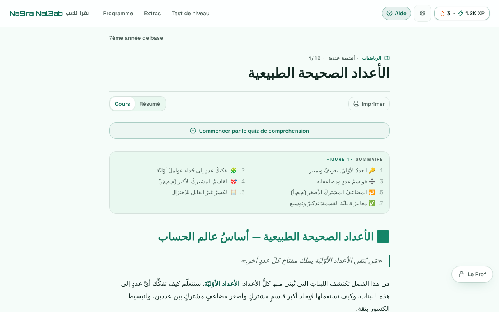
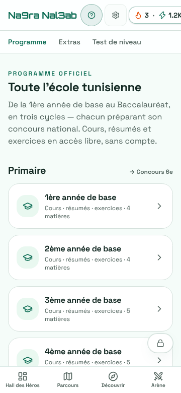
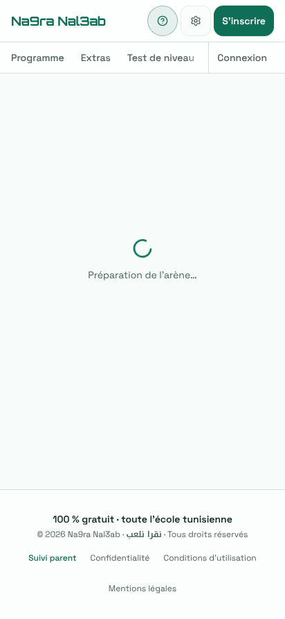
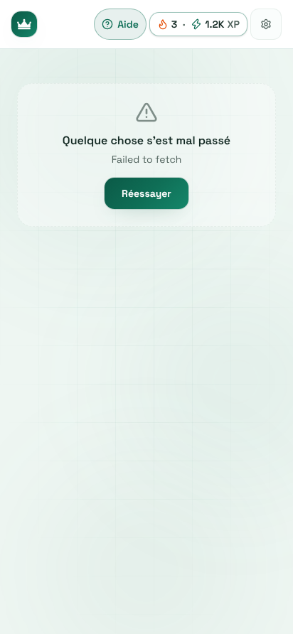

# Audit — navigation entre les menus, configuration de la navigation, fluidité (2026-11-21)

> **Commande du propriétaire** : « un audit sur la navigation entre les menus, l'architecture de la
> configuration de la navigation entre menus, la fluidité de navigation dans la plate-forme (mode
> anonyme, connecté, passage entre modes) ».
>
> **Nature** : un relevé, aucun code applicatif modifié. `main` à #1350. Chaque constat porte sa
> provenance : **[M]** mesuré dans un navigateur réel, **[C]** lu dans le code par l'auteur de
> l'audit, **[R]** relevé par une relecture déléguée et non re-vérifié (regroupés en annexe).
> Ce qui n'a pas été mesuré est dit non mesuré (§ 9).
>
> Ce document remplace, pour son sujet, l'audit archivé du 29 juin
> ([`archive/2026-06-29-audit-fluidite-navigation.md`](./archive/2026-06-29-audit-fluidite-navigation.md)),
> dont le verdict « navigation saine » décrivait deux coquilles qui ont changé depuis.

## 0. En bref

La navigation **tient pour un visiteur sans compte sur téléphone** — c'est le parcours le plus
soigné du produit : aucun mur de connexion, remontée complète niveau → matière → cours, retour à
la page de départ après une connexion, défilement restauré au Retour. Les défauts sont ailleurs :
**dans le mode connecté dès qu'il sort de son Hall, et à la couture entre les deux modes.**

Cinq constats majeurs, tous reproduits :

| #   | Constat                                                                                                                                                                                                             | Qui le subit                                   |
| --- | ------------------------------------------------------------------------------------------------------------------------------------------------------------------------------------------------------------------- | ---------------------------------------------- |
| N-1 | **Sur ordinateur, l'élève connecté perd ses menus sur tout le catalogue.** Dès 1 024 px, les pages programme, classe, matière et cours n'affichent plus Hall · Parcours · Arène — seulement le menu du visiteur.    | tout élève connecté sur ordinateur             |
| N-2 | **Sur téléphone, l'en-tête du catalogue déborde de l'écran pour un connecté** : 17 à 40 px à 360 px de large, jusqu'à 53 px à 320 px. Le test qui devait l'empêcher passe à 2 px près, avec un compte à 0 XP.       | tout élève connecté sur un téléphone < 400 px  |
| N-3 | **Le bouton Retour est piégé à trois endroits** : après un lien vers un écran de compte (visiteur), après l'assistant d'accueil, et après toute connexion.                                                          | visiteurs et élèves, tous appareils            |
| N-4 | **Quatre écrans de jeu peuvent laisser l'élève sans issue** : un exercice dont la lecture échoue tourne sans fin ; une quête qui ne démarre pas n'offre que « Réessayer » ; le résultat d'un examen n'a aucun lien. | élèves, surtout sur réseau instable            |
| N-5 | **Un élève connecté peut jouer en mode visiteur sans le savoir** — donc sans XP : liens servis trop tôt, liens partagés, et retour après inscription.                                                               | élèves connectés, nouveaux inscrits en premier |

Un sixième fait, hors protocole, a été **observé en production pendant l'audit** (N-18) : pendant
une publication de contenu, des pages matière ont perdu leurs missions, sans rien en dire.

Côté **architecture**, il n'existe pas de configuration de la navigation : les destinations, les
écrans « immersifs », les cibles de retour et les règles par rôle sont répartis sur une douzaine
de fichiers, dont plusieurs listes parallèles qui ont déjà divergé (§ 6). Les deux coquilles
(publique, connectée) sont deux arbres distincts qui relisent chacun la session : c'est la cause
directe de N-1, de N-5 et du clignotement mesuré à chaque passage de l'une à l'autre (N-6).

Six décisions reviennent au propriétaire (§ 8) ; le reste se corrige sans arbitrage (§ 7, lots 1
à 3).

## 1. Protocole

|                   |                                                                                                                                                                                                                                                                                                                  |
| ----------------- | ---------------------------------------------------------------------------------------------------------------------------------------------------------------------------------------------------------------------------------------------------------------------------------------------------------------- |
| Lecture           | toutes les routes (`src/routes/**`, 49 fichiers), les deux coquilles, les composants de navigation, le tunnel de compte, le routeur ; graphe des liens extrait par script (cible → fichiers qui la lient)                                                                                                        |
| Navigateur        | Chromium (Playwright) sur le **build de production** de `main`, servi en local ; lectures anonymes sur le catalogue réel                                                                                                                                                                                         |
| Largeurs          | 320 · 360 · 375 · 390 · 412 px (téléphone), 820 px (tablette), 1 100 · 1 280 · 1 440 px (ordinateur)                                                                                                                                                                                                             |
| Téléphone de réf. | celui du relevé du 12 novembre : processeur ÷4, 1,6 Mbit/s descendant, 750 kbit/s montant, 150 ms                                                                                                                                                                                                                |
| Mode connecté     | une **session simulée** — aucun compte créé, aucune écriture : un faux jeton dans le navigateur, le profil (élève, élève sans classe, parent) servi par la sonde. Les écrans connectés montrent donc leur coquille, leurs gardes et leurs redirections, **pas leurs données** (celles-ci sont lues dans le code) |
| Mesure d'audience | coupée dans la sonde : rien n'est parti vers GA4 ni PostHog                                                                                                                                                                                                                                                      |
| Relectures        | deux relectures déléguées (écrans connectés, écrans publics) ; leurs constats majeurs ont été re-vérifiés un par un avant d'entrer ici, les autres sont en annexe [R]                                                                                                                                            |
| Rejouer           | [`audit-navigation-2026-11-21/sonde/`](./audit-navigation-2026-11-21/sonde/README.md)                                                                                                                                                                                                                            |

## 2. Ce qui tient — vérifié, à ne pas ré-auditer

- **Aucun mur de connexion sur le contenu** ; les écrans de compte ne montrent jamais leur contenu
  à un visiteur (la garde se ferme aussi quand la session est illisible). [C]
- **Retour à la page de départ après connexion** : depuis l'en-tête d'une page de contenu,
  connexion puis retour sur cette page, mesuré. « Connexion » puis Retour ramène bien à la page
  d'origine. [M]
- **Remontée du catalogue** : classe → programme, matière → classe, cours → matière et classe
  [M] ; exercice → matière [C, et gardé par l'e2e]. Les deux manques relevés en juin (matière →
  niveau, chapitre → matière) sont comblés.
- **Se déconnecter depuis une page publique laisse sur la page**, en visiteur. [M]
- **Le défilement est restauré au Retour** : 686 px → 686 px sur le programme, 2 958 → 2 958 sur
  une matière. [M]
- **Le premier tap répond vite, même sans rien en cache** : sur le téléphone de référence, l'écran
  change 160 à 340 ms après le tap. [M]
- **L'en-tête public ne ment pas sur l'état du compte** pendant la lecture de la session (place
  réservée, aucun libellé). [M]
- Des briques uniques existent et sont testées : les quatre onglets de l'élève
  (`student-nav.ts`), l'espace d'un rôle (`hub-route.ts`), le lien de retour (`BackLink`, 23
  usages), la mémoire de retour (`return-to.ts`), la liste des consoles comparée aux fichiers de
  routes par un test.

## 3. Carte des menus — ce que chacun voit, mesuré

| Qui, où                                           | < 1 024 px                                                                                 | ≥ 1 024 px                                                                |
| ------------------------------------------------- | ------------------------------------------------------------------------------------------ | ------------------------------------------------------------------------- |
| Visiteur, pages publiques                         | marque · Programme · Extras · Test de niveau · Suivi parent · Connexion · Créer mon compte | idem, sur une ligne dès 1 280 px                                          |
| Élève connecté, **espace connecté**               | onglets du bas : Hall des Héros · Parcours · Découvrir · Arène                             | les mêmes quatre, dans l'en-tête                                          |
| Élève connecté, **catalogue** (coquille publique) | en haut Programme · Extras · Test de niveau **et** en bas les quatre onglets               | Programme · Extras · Test de niveau **seulement** — plus aucun menu élève |
| Élève connecté, écran de jeu                      | aucun menu (quête, examen, assistant d'accueil, exercice, test en cours)                   | idem                                                                      |
| Parent connecté, espace connecté                  | Suivi                                                                                      | Suivi                                                                     |
| Parent connecté, catalogue                        | menu du visiteur + « Suivi parent » ; marque et puce de compte → `/dashboard`              | idem                                                                      |
| Page 404                                          | hors de toute coquille : « Retour à l'accueil » · « Programme »                            | idem                                                                      |

Trois lectures de ce tableau :

1. Le même élève a **trois barres différentes** selon l'endroit et la largeur de l'écran ; sur
   téléphone, au catalogue, il en a deux à la fois, avec deux éléments allumés pour la même page
   (« Programme » en haut, « Découvrir » en bas).
2. Le catalogue est l'endroit où l'on **apprend** (matière, cours) : c'est précisément là que
   l'élève sur ordinateur n'a plus ses menus.
3. La même page porte **plusieurs noms** : l'onglet « Découvrir », l'entrée « Programme », les
   cartes du Hall « Découvrir d'autres thèmes » et « Changer de classe » mènent toutes à
   `/programme`.

## 4. Constats

Sévérité : 🔴 friction nette dans un parcours courant · 🟡 friction localisée · ⚪ confort.

### 🔴 N-1 — Sur ordinateur, l'élève connecté perd ses menus sur le catalogue [M]

Le 15 novembre, la barre d'onglets a été montée dans la coquille publique pour que l'élève ne
« perde plus ses onglets en ouvrant une matière depuis son Hall ». Elle est `lg:hidden`
(`src/components/student-tab-bar.tsx:24`) : au-delà de 1 024 px, c'est l'en-tête qui doit porter la
navigation — or l'en-tête public ne porte que le menu du catalogue
(`src/components/public/public-header.tsx:105-124`). Mesuré à 1 100, 1 280 et 1 440 px sur
`/programme`, `/niveau`, `/matiere` et `/chapitre` : ni Hall, ni Parcours, ni Arène. Pour aller
d'un cours à l'Arène : marque → Hall → Arène, deux clics et une bascule de coquille, là où le
téléphone en demande un. Entre 1 024 et 1 279 px s'y ajoute un en-tête sur deux rangées (114 px).

### 🔴 N-2 — Sur téléphone, l'en-tête du catalogue déborde pour un connecté [M]

Marque + aide + réglages + puce de compte ne tiennent pas sur une ligne
(`public-header.tsx:76-150`). Débordement horizontal du document, mesuré sur `/programme` :

| Série · XP affichés | 320 px | 360 px | 375 px | 390 px | 412 px |
| ------------------- | ------ | ------ | ------ | ------ | ------ |
| 0 · 0 XP            | 30     | 17     | 2      | 0      | 0      |
| 12 · 950 XP         | 52     | 39     | 24     | 9      | 0      |
| 3 · 1.2K XP         | 47     | 35     | 20     | 5      | 0      |
| 120 · 123.5K XP     | 53     | 40     | 25     | 10     | 0      |

Mêmes valeurs en arabe, du côté gauche. Conséquence : la page glisse de côté ou s'affiche réduite
selon le navigateur, et la puce de compte est coupée. La coquille connectée, elle, est protégée
(la marque y devient une icône sous 640 px).

**Pourquoi le gate ne le voit pas** : la plus petite largeur testée est 375 px
(`e2e/helpers/viewports.ts`), la tolérance est de 2 px, et le compte de test repart à 0 XP —
exactement la case « 2 » du tableau. Le téléphone de référence du projet (360 px) n'est pas dans
la liste.

### 🔴 N-3 — Le bouton Retour est piégé [M]

Les gardes et le tunnel naviguent en **empilant** une entrée d'historique au lieu de remplacer
celle qui redirige. Le dépôt sait faire l'inverse : `use-redirect-connected-parent.ts:26` remplace.

| Scénario                                                                  | Mesuré                                                                                                  | Code                                   |
| ------------------------------------------------------------------------- | ------------------------------------------------------------------------------------------------------- | -------------------------------------- |
| Un visiteur suit un lien vers `/parcours` (WhatsApp, favori)              | renvoyé à `/auth` ; Retour ×3 : chaque fois `/parcours` → `/auth`. Il ne peut pas revenir d'où il vient | `src/routes/_authenticated.tsx:114`    |
| Un élève sans classe ouvre son Hall                                       | renvoyé à l'assistant ; Retour ×2 : `/dashboard` → `/onboarding`                                        | `_authenticated.tsx:135`               |
| Un visiteur se connecte depuis une page de contenu                        | revient bien sur sa page ; puis Retour : `/auth` → `/dashboard`, à chaque fois. Sa page est perdue      | `src/routes/auth.tsx:66-72`            |
| Un parent arrive sur `/dashboard` (connexion, marque, « Retour au hall ») | non mesurable en session simulée ; même forme dans le code : navigation sans `replace`                  | `_authenticated/dashboard.tsx:161-165` |

### 🔴 N-4 — Des écrans de jeu sans issue

Ces écrans sont « immersifs » : la barre d'onglets y est masquée à dessein. Une panne y laisse
donc pour seule sortie le logo de l'en-tête.

| Écran                                 | Ce qui arrive                                                                                                                                                             | Preuve                                                                                                   |
| ------------------------------------- | ------------------------------------------------------------------------------------------------------------------------------------------------------------------------- | -------------------------------------------------------------------------------------------------------- |
| Exercice (public) et quête (connecté) | si la lecture de l'exercice échoue — réseau coupé après le chargement de la page —, « Préparation de l'arène… » **sans fin** : 30 s mesurées, aucun bouton, aucun message | [M] ; `src/features/quest/components/exercise-player.tsx:201-206, 637-639` (ni `isError`, ni hors-ligne) |
| Quête qui ne démarre pas              | un seul bouton « Réessayer », et le message technique brut (« Failed to fetch »), en anglais                                                                              | [M] ; `quest-session-error.tsx:27-41`, `exercise-player.tsx:702-717`                                     |
| Résultat d'un examen blanc            | après un entraînement : aucun lien. Après un classé : seulement « Refaire en entraînement »                                                                               | [C] `_authenticated/examen.$examId.tsx:227-251`, `features/exam/components/exam-results.tsx:176-184`     |
| Assistant d'accueil                   | aucune sortie à l'écran ; la marque et la puce y ramènent (N-3). Reste la déconnexion, dans les réglages                                                                  | [M] pour la boucle ; [R] pour l'écran                                                                    |

### 🔴 N-5 — Connecté, mais en mode visiteur

`/exercice/…` (entraînement sans compte, rien n'est enregistré) et `/quest/…` (quête, XP) sont
deux routes ; le choix se fait au rendu, sur « une session est-elle lue ? »
(`src/features/quest/exercise-route.ts:16-20`). Trois chemins mènent un élève **connecté** du
mauvais côté, et rien ne l'en sort :

1. **Les liens servis trop tôt.** [M] Sur une page matière ouverte directement, les liens de
   mission pointent vers `/exercice/…` tant que la session n'est pas lue : 0,4 s sans bridage,
   **3,3 s sur le téléphone de référence** (de 5,9 s à 9,2 s après l'ouverture). Un tap dans cette
   fenêtre fait jouer sans XP.
2. **Les liens partagés.** [C] Les pages `/exercice/…` sont au sitemap et dans les partages. Un
   élève connecté qui en ouvre une reste en mode visiteur (`rewards: false`,
   `src/routes/_public/exercice.$exerciseId.tsx:100-112`) ; le lien vers la quête n'apparaît que
   sur l'écran de résultat (`:306-313`).
3. **Le retour après inscription.** [C] La carte de fin d'entraînement promet « avec un compte,
   cette mission vaut jusqu'à N XP » et retient la page (`:324-333`). Le nouvel inscrit est donc
   ramené sur `/exercice/…` : il rejoue la mission… sans XP, au moment exact où on vient de les
   lui promettre.

### 🟡 N-6 — Passer d'une coquille à l'autre fait clignoter l'écran [M]

De la coquille publique vers l'espace connecté (onglet « Hall » depuis le catalogue), tout est
démonté : un écran plein « Chargement… » s'affiche, sans en-tête ni onglets, pendant **100 ms**
(processeur ÷4) à **145 ms** (÷6) ; sans bridage il tient en une image. Dans l'autre sens, la barre
d'onglets disparaît puis revient (66 ms au premier passage). Cause : § 6, A-2. S'y ajoute, à la
première ouverture du catalogue depuis l'espace connecté, un décalage de mise en page de **0,21** :
le pied de page s'affiche à l'écran, puis est repoussé quand la liste des classes arrive
(squelette plus court que l'écran).

### 🟡 N-7 — Se déconnecter : deux navigations pour un geste [M]

Le code envoie vers l'accueil avec « à bientôt » (`_authenticated.tsx:152-156`) ; la garde, elle,
voit la session disparaître et pousse `/auth`. Mesuré : on arrive sur **l'écran de connexion**,
l'accueil reste dans l'historique. Le test e2e fige ce résultat (`e2e/authed/logout.spec.ts:17-30`)
alors que le code écrit l'intention inverse. À trancher (§ 8, Q-4).

### 🟡 N-8 — Le parent hors de son espace

- Dans la coquille publique, la marque et la puce de compte mènent à `/dashboard` pour tout
  connecté (`public-header.tsx:84`, `src/components/account-hud.tsx:25`), jamais à l'espace du rôle
  que `hubRouteForRole` sait pourtant donner. Le parent passe donc par le Hall de l'élève. [M]
- La redirection hors du Hall attend **toute la charge du tableau de bord**
  (`dashboard.tsx:161-165` lit `data.profile.role`) alors que la coquille connaît déjà le rôle. Si
  cette lecture échoue, le parent reste devant « Impossible de charger le dashboard » — un écran
  qui n'est pas le sien. [M en session simulée]
- La puce de compte montre série et XP à un parent, qui n'a pas de profil de jeu. [M]
- Aucun écran d'élève ne refuse un parent qui en ouvre l'adresse : il s'affiche, sans onglets
  (`_authenticated.tsx:164-165, 297`). [C pour `/arene` ; R pour les autres]

### 🟡 N-9 — L'accueil d'un élève connecté est la vitrine [M]

L'application installée s'ouvre sur `/?src=pwa` (`public/manifest.webmanifest`) et `/` ne tient
pas compte de la session : l'élève connecté qui lance l'app, ou tape l'adresse du site, voit la
page de présentation (« Tous les cours de l'école tunisienne… ») et doit toucher « Hall ». La page
404 lui propose de même « Retour à l'accueil ». Le correctif #312 avait pourtant établi la règle
pour la marque : un connecté ne doit pas atterrir sur l'accueil du visiteur.

### 🟡 N-10 — La hiérarchie des retours n'est pas régulière [C]

| Écran                                          | Retour actuel                                                                       | Attendu par sa place dans les menus      |
| ---------------------------------------------- | ----------------------------------------------------------------------------------- | ---------------------------------------- |
| Donjon, Duels, Classement (enfants de l'Arène) | « Retour au hall » → `/dashboard`                                                   | l'Arène                                  |
| Examens blancs (enfant de l'Arène)             | aucun                                                                               | l'Arène                                  |
| Sept consoles d'administration                 | `/dashboard`                                                                        | la Console (seule `admin.ia` y revient)  |
| Section de 2ᵉ, 3ᵉ ou bac (`/niveau/…`)         | `/programme` (`parcours-subjects.tsx:64`)                                           | la page de l'année, `/programme/lycee/…` |
| Paramétrage, Forge                             | aucun                                                                               | la page d'où l'on vient                  |
| `/console` ouverte par un élève                | la liste des neuf consoles s'affiche, chacune refuse ensuite (`console.tsx:53-120`) | un refus, une fois                       |

### 🟡 N-11 — La page de départ se perd à trois endroits [C]

- **Vote d'intérêt d'une section de lycée** : le visiteur est envoyé à `/auth` sans mémoire de
  retour (`_public/programme_.lycee.$annee.tsx:84-87`) ; il atterrit au Hall, son vote n'est pas
  rejoué.
- **Lien profond d'un élève sans classe** : l'assistant accepte un `?redirect=`
  (`_authenticated/onboarding.tsx:585-597`) que personne n'émet — la garde navigue sans lui. Il
  finit toujours au Hall.
- **Mémoire périmée** : une invitation cliquée sur un cours puis abandonnée reste en mémoire 24 h ;
  une inscription faite plus tard depuis l'accueil (qui n'écrit ni n'efface rien,
  `src/shared/lib/return-to.ts:158`) ramène sur l'ancien cours.

### 🟡 N-12 — Quitter une partie en cours [C]

« Quitter le donjon » est un simple lien, sans confirmation (`_authenticated/dungeon.tsx:529-531`),
et les onglets restent visibles pendant la partie. Or les gains ne sont crédités qu'à la
finalisation (`finalize_dungeon_run`, appelée par `endRun`, `:292-298`) et le quota du jour compte
les parties créées : quitter à l'étage 9 perd les XP et une partie. La quête, elle, garde bien le
travail (brouillon local, reprise). [R pour le duel : quitter pendant la recherche ne quitterait
pas la file.]

### 🔴 N-18 — Observé en production pendant l'audit : des pages matière sans leurs missions [M]

Hors du protocole, constaté en rejouant la sonde. Le 21 novembre, de 16:17 à 16:21 UTC au moins,
sur le site en production, `/matiere/math-7eme` (14 chapitres) et `/matiere/math` (21 chapitres)
n'affichaient **ni quiz ni mission** à un visiteur — seulement « Lire le cours ». Une heure plus
tôt, les mêmes pages les listaient. Deux faits, à ne pas confondre :

1. **La lecture échouait.** La liste des exercices d'une matière — la requête que fait la page —
   répondait `500 · canceling statement due to statement timeout` après 3,6 à 4 s (relevée trois
   fois entre 16:19 et 16:21). Au même moment, la publication de contenu n° 361
   (`apply-content.yml`, dépôt privé) était à son étape « Appliquer le contenu », commencée à
   16:12:26. La publication s'est terminée à 16:23:25 ; à 16:26 la même lecture répondait en
   1,1 s et les missions étaient revenues sur les deux pages. Le lien de cause n'est pas démontré,
   mais la fenêtre de panne est celle de l'application.
2. **La page avale l'erreur.** `const exercises = exs.data ?? []`
   (`src/features/quest/quest.server.ts:321` ; même forme pour les chapitres, `:401`) : une lecture
   en échec donne une matière « sans mission », sans message ni « Réessayer », pour un visiteur
   comme pour un élève connecté. C'est l'écran sans issue le plus silencieux du relevé — rien ne
   dit qu'il manque quelque chose. [C]

À instruire avant d'en faire un lot : la durée réelle de la fenêtre, si chaque publication la
produit (il y en a eu quatre ce jour-là), et pourquoi une lecture par matière dépasse le délai
pendant l'application.

### ⚪ Nits

- **N-13** L'ordre des contrôles de l'en-tête s'inverse entre les coquilles : puce puis réglages
  dans l'espace connecté (`_authenticated.tsx:261-263`), réglages puis puce au catalogue
  (`public-header.tsx:132-150`). [M]
- **N-14** À 1 100 px, « Hall des Héros » passe sur deux lignes dans l'en-tête connecté. [M]
- **N-15** Deux liens internes passent encore par la redirection héritée `/lesson/…` :
  `features/progression/components/weaknesses-panel.tsx:182`,
  `features/quest/components/quest-review-list.tsx:207`. [C]
- **N-16** Après une navigation, le focus retombe sur `<body>` et rien n'annonce la nouvelle page à
  un lecteur d'écran ; pas de lien « aller au contenu ». [M]
- **N-17** Le pied de page montre « Suivi parent » à un élève connecté, que l'en-tête lui masque
  (`public-footer.tsx:32` / `public-header.tsx:54`). [C]

## 5. Mesures de fluidité (téléphone de référence, build de production)

| Geste                                                  | Rien en cache                                | Tout en cache |
| ------------------------------------------------------ | -------------------------------------------- | ------------- |
| Visiteur : Programme → Classe, premier changement      | 343 ms                                       | 185 ms        |
| Visiteur : Classe → Matière                            | 201 ms                                       | 119 ms        |
| Visiteur : Matière → Cours                             | 156 ms                                       | 141 ms        |
| Visiteur : titre de la nouvelle page affiché           | 1,6 à 1,75 s                                 | 1,2 à 1,4 s   |
| Élève : Hall → Arène (même coquille)                   | 205 ms, titre à 305 ms                       | 87 ms         |
| Élève : Arène → catalogue (bascule)                    | 282 ms, onglets absents 66 ms                | 199 ms        |
| Élève : catalogue → Hall (bascule), processeur ÷4      | écran plein « Chargement… » pendant 100 ms   | idem          |
| Élève : liens de mission corrects sur une page matière | 9,2 s après l'ouverture (visiteur dès 5,9 s) | —             |

Lecture : les transitions sont rapides ; le temps perçu vient des **données** (1,2 s et plus, sous
squelette), pas du code. Ce qui se voit est le clignotement des bascules (N-6) et la fenêtre de
N-5.

## 6. Architecture de la configuration de navigation

### A-1 — Il n'y a pas de configuration : une douzaine de sources [C]

| Ce qu'il faut savoir d'un écran                 | Où c'est écrit                                                                                                                                                               | Source unique ?                                            |
| ----------------------------------------------- | ---------------------------------------------------------------------------------------------------------------------------------------------------------------------------- | ---------------------------------------------------------- |
| Les quatre onglets de l'élève                   | `src/components/student-nav.ts`                                                                                                                                              | ✅ une liste, deux rendus                                  |
| Le menu du visiteur                             | `public-header.tsx`, écrit **deux fois** (`:106-123` et `:194-207`)                                                                                                          | ❌                                                         |
| Les entrées parent et admin                     | en ligne dans `_authenticated.tsx:218-251`                                                                                                                                   | ❌                                                         |
| Le pied de page, le pôle Arène, le pôle Console | en ligne dans `public-footer.tsx`, `arene.tsx:27-58`, `console.tsx:81-120`                                                                                                   | Console seule gardée par un test                           |
| L'espace d'un rôle                              | `features/auth/hub-route.ts`                                                                                                                                                 | ✅ mais contournée : `/dashboard` est écrit en dur 59 fois |
| Les écrans sans menu                            | `shared/lib/immersive-paths.ts` (deux expressions) **et** `features/ai/components/ai-launcher.tsx:49` (une troisième liste) **et** `features/auth/onboarding-guard.ts:20-28` | ❌ trois listes                                            |
| La fiche d'aide d'un écran                      | `shared/lib/guide.ts:17-26` (dix expressions)                                                                                                                                | ❌                                                         |
| « Est-ce le tunnel de compte ? »                | `shared/lib/return-to.ts:33` **et** `shared/lib/funnel-origin.ts:20`                                                                                                         | ❌ deux expressions                                        |
| La cible du retour d'un écran                   | une chaîne dans chaque écran                                                                                                                                                 | ❌ (N-10)                                                  |
| Les anciennes adresses                          | quatre routes de redirection                                                                                                                                                 | ✅                                                         |

Les divergences sont déjà là : les deux expressions du tunnel ne sont pas les mêmes (l'une ignore
la casse, l'autre non) ; la liste de la bulle IA couvre `/examens`, que `immersive-paths` écarte
exprès par une barre oblique ; `lesson` figure encore parmi les écrans immersifs et les fiches
d'aide alors que ce n'est plus qu'une redirection ; le commentaire de la coquille dit que les
onglets du donjon restent « jusqu'au début d'une partie », ils restent pendant.

Le dépôt a déjà payé ce défaut deux fois sur la Console (`/admin/economie`, puis
`/admin/engagement`, livrées sans leur entrée) et y a répondu par un test qui compare la liste aux
fichiers de routes. Ce garde-fou ne couvre que la Console.

### A-2 — Deux coquilles, deux arbres, et une session relue partout [C] [M]

`_public` et `_authenticated` sont deux routes de mise en page sœurs : passer de l'une à l'autre
démonte l'en-tête, la barre d'onglets, la bulle IA et le bandeau réseau, puis les remonte. Et
`useAuth` n'est pas un contexte partagé mais un hook à état local (`features/auth/use-auth.ts:7-9`),
appelé dans **17 fichiers** : chaque montage relit la session et repart de « je ne sais pas ».
Une page de catalogue la lit six fois ou plus (coquille, en-tête, rôle ×2, puce, page).

Conséquences mesurées : l'écran plein de N-6, la barre d'onglets qui disparaît et revient, les
liens de visiteur servis à un connecté (N-5). Conséquence de structure : chaque coquille doit
réapprendre ce que l'autre sait — d'où une barre d'onglets montée deux fois avec deux listes
d'exclusion, et un en-tête public qui n'a jamais reçu le menu de l'élève (N-1).

### A-3 — Les gardes sont des effets, et ils empilent [C]

La session ne vit que dans le navigateur : le serveur ne peut pas décider, les gardes sont donc
des `useEffect` dans la coquille (justifié et documenté). Mais trois d'entre eux naviguent sans
`replace` (N-3), deux se disputent la déconnexion (N-7), et la redirection du parent est décidée
par une page plutôt que par la coquille (N-8).

### A-4 — Le routeur : un réglage mort, des données hors du routeur [C]

`defaultPreloadStaleTime: 30_000` (`src/router.tsx:102`) annonce un préchargement qui n'existe
pas : ni `defaultPreload`, ni `preload` sur un seul lien. Les `loader` ne servent qu'au rendu
serveur ; en navigation, chaque page charge ses données elle-même, sous squelette. Le coût mesuré
est faible (§ 5) : c'est une opportunité, pas un défaut — mais le réglage laisse croire le
contraire.

### A-5 — Ce que les tests gardent, et ce qu'ils ne gardent pas

Gardé : la barre d'onglets, les deux coquilles, les écrans immersifs, la mémoire de retour, les
fiches d'aide, l'espace d'un rôle, la garde d'accueil (tests unitaires) ; les liens de la
navigation et la déconnexion (e2e). Non gardé : le bouton Retour, un connecté au catalogue à
1 024 px et plus, un connecté au catalogue à 360 px avec des XP, les états d'erreur des écrans
immersifs. Et aucune suite e2e ne conditionne une fusion : une régression de navigation se voit au
plus tôt à la nuit suivante.

## 7. Lots proposés

| Lot | Contenu                                                                                                                                                                                                                                                                                                               | Constats                        | Taille | Arbitrage |
| --- | --------------------------------------------------------------------------------------------------------------------------------------------------------------------------------------------------------------------------------------------------------------------------------------------------------------------- | ------------------------------- | ------ | --------- |
| 1   | **Le Retour ne piège plus** : `replace` sur les trois gardes et sur la sortie de `/auth` ; la redirection du parent décidée par la coquille ; marque et puce de l'en-tête public vers l'espace du rôle ; un test par scénario                                                                                         | N-3, N-8                        | petit  | non       |
| 2   | **Aucun écran sans issue** : état d'erreur et hors-ligne du lecteur d'exercice, sorties sur la quête qui ne démarre pas, sur le résultat d'examen et dans l'assistant ; message d'erreur traduit ; la page matière dit quand la lecture de ses missions échoue                                                        | N-4, N-18 (2)                   | petit  | non       |
| 3   | **L'en-tête tient à 320 px** pour un connecté ; 360 px et un compte avec des XP entrent dans les largeurs testées ; ordre des contrôles aligné                                                                                                                                                                        | N-2, N-13, N-14                 | petit  | non       |
| 4   | **Le mode suit le compte** : menus de l'élève dans l'en-tête du catalogue dès 1 024 px ; un connecté sur `/exercice` basculé vers la quête ; l'accueil d'un connecté                                                                                                                                                  | N-1, N-5, N-9                   | moyen  | Q-1 à Q-3 |
| 5   | **Une session, une carte** : la session lue une fois et partagée (fin des dix-sept lectures) ; un registre des écrans (coquille, rôle, immersif, parent dans les menus, fiche d'aide) dont dérivent menus, retours et listes, avec un test qui le compare aux routes ; ménage du réglage mort et des entrées héritées | N-6, N-10, N-15, A-1 à A-4      | grand  | non       |
| 6   | **Ce qui reste** : retours perdus (N-11), sortie d'une partie (N-12), déconnexion (N-7), noms (§ 3), focus et annonce de page (N-16) ; la fenêtre de lecture pendant une publication (N-18), à instruire avec le pipeline de contenu                                                                                  | N-7, N-11, N-12, N-16, N-18 (1) | moyen  | Q-4 à Q-6 |

Les lots 1 à 3 sont indépendants et sans risque de régression de comportement voulu. Le lot 5
rend le lot 4 plus simple s'il passe avant ; l'inverse reste possible.

## 8. Arbitrages demandés au propriétaire

| #   | Question                                                                                         | Recommandation                                                                                                                        |
| --- | ------------------------------------------------------------------------------------------------ | ------------------------------------------------------------------------------------------------------------------------------------- |
| Q-1 | Sur ordinateur, que voit l'élève connecté dans l'en-tête du catalogue ?                          | Ses quatre destinations, comme sur téléphone : c'est la décision du 15 novembre étendue aux grands écrans.                            |
| Q-2 | Un élève connecté ouvre un lien d'entraînement sans compte (`/exercice/…`) : que se passe-t-il ? | Il est conduit à la quête (XP) dès que sa session est lue, sans trace dans l'historique. Vaut aussi pour le retour après inscription. |
| Q-3 | Un élève connecté ouvre l'accueil, ou lance l'application installée : où arrive-t-il ?           | Dans son espace (Hall, ou Suivi pour un parent). La vitrine reste celle du visiteur et des moteurs de recherche.                      |
| Q-4 | Après « Se déconnecter » depuis l'espace connecté : accueil ou écran de connexion ?              | L'accueil, avec « à bientôt » — ce que le code écrit déjà. L'écran de connexion actuel est le résultat d'une course, pas d'un choix.  |
| Q-5 | Un seul nom pour le catalogue : « Programme » ou « Découvrir » ?                                 | « Programme », partout (onglet compris) ; « Changer de classe » garde son libellé mais annonce où il mène.                            |
| Q-6 | Quitter un donjon en cours : confirmer ? créditer ce qui est acquis ?                            | Les deux : une confirmation, et la partie est finalisée à la sortie.                                                                  |

## 9. Hypothèses réfutées, et ce qui n'a pas été mesuré

Réfuté par la mesure :

- _« Sans préchargement, un tap ne répond pas. »_ Faux : 160 à 340 ms sans rien en cache (§ 5).
- _« Chaque passage vers l'espace connecté montre un long écran de chargement. »_ À nuancer : une
  image sans bridage, 100 à 145 ms sur un téléphone lent (N-6).

Non mesuré :

- Les écrans connectés **avec leurs données** (session simulée) : le contenu du Hall, d'une quête
  en cours, d'un examen, de la boutique, du suivi parent est lu dans le code.
- Un vrai téléphone : Chromium émulé seulement ; le comportement exact d'un débordement (glisser
  ou rétrécir) dépend du navigateur.
- La connexion Google, la confirmation par e-mail, la réinitialisation du mot de passe : lues,
  non rejouées.
- L'anglais et l'arabe, hors le débordement de l'en-tête (N-2).
- La production elle-même : tout a été mesuré sur le build de `main` servi en local, sauf N-18.
- N-5 (1) : quatre mesures par profil, concordantes (0,43 à 0,53 s sans bridage ; 3,25 à 3,33 s
  sur le téléphone de référence). Les rejeux lancés pendant la publication de 16:12 ne listaient
  plus aucune mission (N-18) et ne comptent pas.

## 10. Suivi des corrections

Le propriétaire a demandé de corriger au fil de l'eau (2026-11-21). Une ligne par constat traité ;
« rejoué » = le scénario de la sonde repassé sur le build corrigé.

| Constat                                          | État                                                                                                                                                                                                                                                                                                                                              | Preuve                                        |
| ------------------------------------------------ | ------------------------------------------------------------------------------------------------------------------------------------------------------------------------------------------------------------------------------------------------------------------------------------------------------------------------------------------------- | --------------------------------------------- |
| N-3 — le bouton Retour piégé                     | ✅ corrigé (lot 1) : les gardes de connexion et d'accueil, et la sortie de `/auth`, remplacent l'entrée d'historique. Rejoué : Retour ramène à la page d'avant dans les trois scénarios                                                                                                                                                           | `historique.cjs` C1, C3, C5 ; tests unitaires |
| N-8 — le parent hors de son espace               | ✅ corrigé (lot 1) pour la marque, la puce de l'en-tête public et le rebond : la coquille décide sur le rôle qu'elle connaît, sans attendre le tableau de bord. Rejoué : la marque mène droit à `/parent-report`. Restent : la puce de jeu montrée à un parent, les écrans d'élève                                                                | `historique.cjs` C4 ; tests unitaires         |
| Découvert en corrigeant — la garde hors coquille | ✅ corrigé (lot 1) : la garde d'accueil lisait l'adresse visée, pas l'écran rendu ; un élève sans classe qui quittait la coquille pour une page publique y était ramené. Les gardes de rôle lisent désormais la route affichée                                                                                                                    | `historique.cjs` C5 ; test « écran RENDU »    |
| N-4 — des écrans de jeu sans issue               | ✅ corrigé (lots 2-3) pour trois écrans sur quatre : un exercice dont la lecture échoue dit la panne (ou l'attente du réseau) avec « Réessayer » et une sortie ; la quête qui ne démarre pas gagne une sortie et ne montre plus le message brut du navigateur ; le résultat d'un examen a son « Retour aux examens ». Reste l'assistant d'accueil | tests de `exercise-player`                    |
| N-18 (2) — la page matière avale l'erreur        | ✅ corrigé (lots 2-3) : une lecture de chapitres ou de missions en échec lève, la page dit « réessayer » au lieu d'une matière vide. La fenêtre de lecture pendant une publication (N-18, 1) reste à instruire                                                                                                                                    | test de `getSubject`                          |
| N-2 — l'en-tête déborde pour un connecté         | ✅ corrigé (lots 2-3) : 0 px de débordement de 320 à 412 px, fr et ar, quel que soit le compte ; sous 400 px la marque et la puce se resserrent, et un compte extrême (120 jours, 123,5K XP) tronque son chiffre au lieu d'élargir la page. Reste à faire entrer 360 px et un compte avec des XP dans l'e2e (projet de test requis)               | `debordement.cjs`                             |
| N-13 — l'ordre des contrôles                     | ✅ corrigé (lots 2-3) : puce puis réglages dans les deux coquilles                                                                                                                                                                                                                                                                                | —                                             |
| N-15 — liens par la redirection `/lesson`        | ✅ corrigé (lots 2-3) : les deux liens visent `/chapitre`                                                                                                                                                                                                                                                                                         | test de la correction                         |
| N-11 — vote d'intérêt lycée sans retour          | ✅ corrigé (lots 2-3) : la page est retenue avant `/auth`. Restent le `?redirect=` de l'assistant et la mémoire périmée                                                                                                                                                                                                                           | —                                             |
| N-1 — l'élève perd ses menus sur ordinateur      | ✅ corrigé (lots 4-6, arbitrage Q-1) : dès 1 024 px l'en-tête du catalogue porte Hall · Parcours · Programme · Arène pour un élève connecté (pas pour un parent). 0 px de débordement de 1 024 à 1 440 px, fr, en, ar, élève et admin ; à côté de ces menus, un admin atteint le Suivi par sa Console                                             | sonde ; test de l'en-tête                     |
| N-5 — connecté, mais en mode visiteur            | ✅ corrigé (lots 4-6, Q-2) : un élève connecté sur `/exercice/…` passe à `/quest/…` dès que sa session et son rôle sont lus, sans trace dans l'historique. Couvre les trois chemins : lien servi trop tôt, lien partagé, retour après inscription. Un parent reste sur l'entraînement                                                             | sonde ; tests de la page                      |
| N-9 — l'accueil d'un connecté                    | ✅ corrigé (lots 4-6, Q-3) : `/` (app installée, adresse tapée, 404) mène l'élève au Hall et le parent à son Suivi. Le rendu serveur garde la vitrine pour les moteurs et les aperçus                                                                                                                                                             | sonde ; `home-redirect.test.tsx`              |
| N-7 — se déconnecter                             | ✅ corrigé (lots 4-6, Q-4) : depuis l'espace connecté ou les paramètres, on arrive sur l'accueil, en visiteur ; la garde ne dispute plus la navigation, et le cache du compte est vidé après le départ. Spec e2e mise à jour                                                                                                                      | sonde ; tests du hook et de la coquille       |
| Noms du catalogue (§ 3)                          | ✅ corrigé (lots 4-6, Q-5) : l'onglet s'appelle « Programme » (fr, en, ar) ; l'élève n'a plus deux « Programme » allumés au catalogue                                                                                                                                                                                                             | sonde                                         |
| N-12 — quitter un donjon en cours                | ✅ corrigé (lots 4-6, Q-6) : « Quitter » demande confirmation et finalise la partie (bilan, XP encaissés) ; partir par un onglet, le logo ou Retour la finalise aussi. Reste : la fermeture de l'onglet du navigateur                                                                                                                             | `dungeon-leave.test.tsx`                      |
| N-8 — fin                                        | ✅ la puce de compte d'un parent ne montre plus série et XP. Reste : aucun écran d'élève ne refuse un parent                                                                                                                                                                                                                                      | test de la puce                               |
| N-11 — fin                                       | ✅ l'assistant d'accueil ramène à l'écran demandé (`?redirect=` enfin émis) ; depuis l'accueil, la mémoire de retour d'une invitation abandonnée est oubliée                                                                                                                                                                                      | tests de la coquille et de `return-to`        |

## Annexe — relevés de relecture, non re-vérifiés [R]

À confirmer avant d'en faire un lot :

- Duel : quitter l'écran pendant la recherche d'adversaire n'arrêterait que l'interrogation, pas
  la file ; l'abandon d'un duel se fait en un tap.
- Examen : le résultat ne survit pas à un rechargement ; pas de vidage des réponses au démontage.
- `/parent-report` ouvert par un élève : le serveur refuse, l'écran affiche « aucun enfant lié »
  avec le formulaire de liaison (corroboré par `e2e/README.md`).
- Hors-ligne : seuls le Hall, le Parcours et les pages du catalogue le disent ; ailleurs une
  lecture en pause donne un faux « introuvable », un faux « aucun examen » ou un chargement sans
  fin (`/programme/lycee/…`, `/test-de-niveau/…`, boutique).
- `/suivi` : « Oublier » laisse le code d'alliance dans l'historique (Retour le recharge).
- « Choisir ce parcours » est offert à un élève sur sa propre classe, et à un parent.
- Test de niveau : si le catalogue ne se lit pas, la liste des classes est vide sans message ;
  « Quitter » un test en cours ne le repropose pas à l'entrée.
- « Mission suivante » suit un ordre différent de celui de la page matière et peut ouvrir sur un
  verrou.
- Retour sur une page matière : les chapitres dépliés sont refermés.
- Une matière introuvable en navigation dit « erreur, réessayer » quand cours et classe disent
  « introuvable ».
