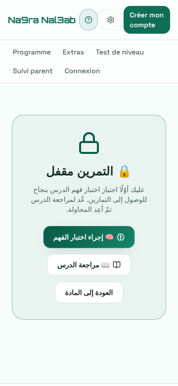
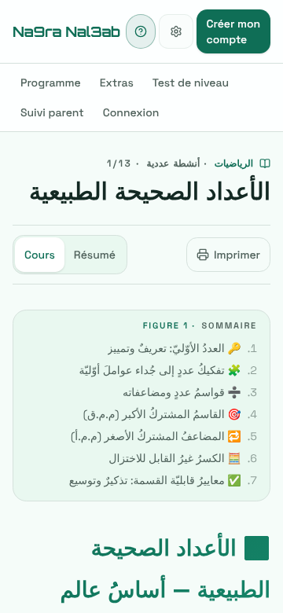
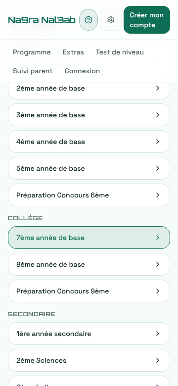
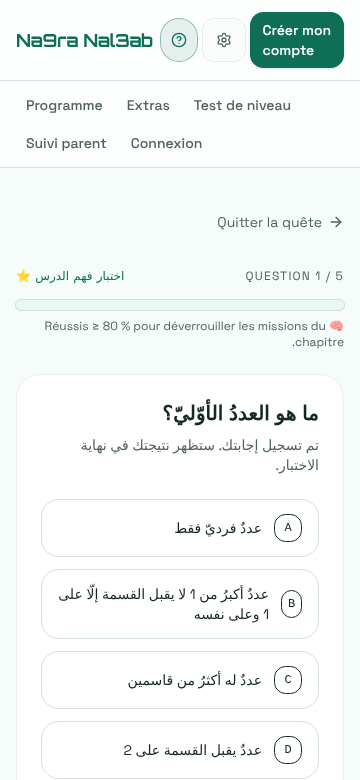
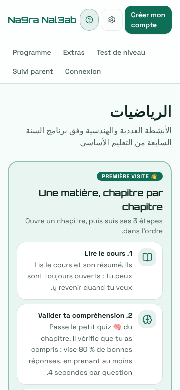

# Relevé — la première visite, sans compte, sur téléphone (2026-11-12)

> **Ce document est un relevé, pas une étude.** Tout ce qui y est affirmé a été **constaté en
> production** (`https://www.na9ranal3ab.tn`, `main` à #1257) le 2026-11-12, dans un navigateur
> réel. Ce qui n'a pas été mesuré est dit non mesuré. Il ne re-spécifie rien de ce que l'étude 38 a
> tranché (retour au point de départ, réseau, continuité du visiteur : ses lots 4 et 5).
>
> **Pourquoi.** 1 171 cours et 6 648 missions en ligne, 3 à 5 élèves actifs par semaine, aucun retour
> la semaine suivante (#962). Depuis le 11 novembre les pages de contenu sont lisibles par Google et
> par les aperçus WhatsApp (#1246, #1251) : la première visite arrive désormais **par une page de
> cours ou d'exercice**, sur un téléphone, sans compte. Ce visiteur ne peut pas être relancé. Sa
> première visite est la seule chance.

## 1. Protocole

|               |                                                                                                                                                                                                                                |
| ------------- | ------------------------------------------------------------------------------------------------------------------------------------------------------------------------------------------------------------------------------ |
| Navigateur    | Chromium (Playwright), contexte neuf à chaque entrée : ni cookie, ni stockage — un **premier** visiteur                                                                                                                        |
| Profil        | téléphone Android milieu de gamme : 360 × 780, tactile, UA Chrome Android ; **processeur ralenti ×4** ; réseau bridé à **1,6 Mbit/s descendant, 750 kbit/s montant, 150 ms de latence**                                        |
| Langues       | français (défaut) et arabe (cookie + stockage `xp-scholars-locale`, comme après un passage par le menu de langue)                                                                                                              |
| Adresses      | prises dans `/sitemap.xml` (6 815 adresses : 5 477 `/exercice`, 1 171 `/chapitre`, 129 `/matiere`, 32 `/niveau`)                                                                                                               |
| « Secondes »  | temps **machine** : un robot qui touche dès que la cible existe. C'est un plancher ; un humain lit, hésite, défile                                                                                                             |
| « Touchers »  | chaque toucher utile (lien, option, bouton). Les défilements sont comptés à part, en écrans de 780 px                                                                                                                          |
| Lecture seule | aucun compte créé, aucun test de niveau démarré (il écrit une session) : le test est mesuré **jusqu'au bouton Commencer**                                                                                                      |
| Trace laissée | les premiers passages ont émis quelques faits PostHog depuis ce navigateur (environ 5 `public_practice_completed`, une trentaine de pages vues) avant que la sonde ne bloque la mesure d'audience. À retrancher du 12 novembre |

Entrées mesurées (7ᵉ année de base, mathématiques — contenu en arabe ; culture générale, histoire —
contenu en français) :

| Entrée                     | Adresse                                          |
| -------------------------- | ------------------------------------------------ |
| cours scolaire             | `/chapitre/a975ef08-6da5-58de-9edb-35868d7221a0` |
| cours non scolaire         | `/chapitre/5a94893c-cdbd-5e43-a0b0-e603b299d966` |
| mission scolaire           | `/exercice/37aad97c-67f2-5723-9a72-e44c58aae8a5` |
| quiz scolaire              | `/exercice/a3d884e2-195e-59ee-8a35-dc94f76f67f0` |
| mission non scolaire       | `/exercice/842d0b7d-9808-571c-bb22-020522a5411c` |
| matière · niveau           | `/matiere/math-7eme` · `/niveau/ecole-7eme-base` |
| accueil · test · programme | `/` · `/test-de-niveau` · `/programme`           |

## 2. Le chargement — identique partout, donc dit une fois

Sur les dix entrées, dans les deux langues : réponse **200**, premier affichage en **1,0 à 1,6 s**,
page interactive et au repos en **5,2 à 6,4 s**, **430 à 515 Ko** transférés. Aucune erreur de
page, aucun mur de connexion, aucun chargement sans fin. Trois faits transverses :

- **L'en-tête occupe 168 px sur 780** (deux rangées : marque + « Créer mon compte », puis cinq
  liens). Sur une question, le bouton **Valider tombe sous la ligne de flottaison** : il est dessiné
  entre 779 et 843 px selon la langue. Chaque question coûte donc un défilement en plus de ses deux
  touchers. (`src/components/public/public-header.tsx` — hors périmètre ; le lecteur,
  `exercise-player.tsx`, peut reprendre sa part.)
- **Tout bouge vers 4 s.** Quand la session est lue, « Créer mon compte » apparaît, l'en-tête
  s'épaissit de 12 px et pousse toute la page : décalage cumulé (CLS) de **0,11 à 0,12 sur chaque
  page publique**. Sur une page matière il atteint **0,57** : la carte « Première visite » s'insère
  au-dessus du contenu déjà affiché et le repousse de 420 px (`subject-hub.tsx`, carte de guide).
- **Une page d'exercice ne contient pas sa question dans le HTML servi** : le serveur rend
  « Préparation de l'arène… », la question arrive à 5 s. (Constat pour l'axe SEO.)

## 3. Tableau par parcours

« 1ʳᵉ réponse » = première question à laquelle le visiteur a répondu ; « 1ᵉʳ verdict » = première
réponse **corrigée** sous ses yeux. Les deux diffèrent : le quiz de compréhension ne corrige rien
question par question.

| Entrée (FR et AR, mêmes chiffres) | Visible sans défiler                                                                                  | 1ʳᵉ réponse                                                                                              | 1ᵉʳ verdict                                                                | Après la correction                                                                                                                             | Impasse                                                                                                | Au rechargement / au retour par le même lien                                              |
| --------------------------------- | ----------------------------------------------------------------------------------------------------- | -------------------------------------------------------------------------------------------------------- | -------------------------------------------------------------------------- | ----------------------------------------------------------------------------------------------------------------------------------------------- | ------------------------------------------------------------------------------------------------------ | ----------------------------------------------------------------------------------------- |
| **Mission non scolaire**          | la question, ses 4 options ; Valider à demi coupé                                                     | 2 touchers · **6,8 s**                                                                                   | 2 touchers · **7,3 s**                                                     | écran de résultat : Recommencer · Retour à la matière · « Avec un compte, cette mission vaut jusqu'à 50 XP » · correction question par question | **pas de mission suivante** : après une réussite (83 %), rien ne propose de continuer                  | question 1, options rebattues ; le résultat et la correction sont perdus                  |
| **Quiz scolaire**                 | la règle (« ≥ 80 % pour déverrouiller »), la question, 4 options                                      | 2 touchers · **5,1 s** (+ 4 s de lecture imposées)                                                       | **jamais** : une note globale à la fin (10 touchers, 36 s)                 | réussi : « Continuer vers le premier exercice » (1 toucher). Raté : « Réviser le cours », Recommencer                                           | **raté = aucune correction** : 5 réponses données, pas une seule dont on sache si elle était juste     | question 1 ; un quiz réussi reste réussi **dans l'onglet seulement**                      |
| **Mission scolaire**              | un cadenas, « exercice verrouillé », trois boutons. **Ni le nom de la mission, ni celui du chapitre** | 3 touchers · **11,6 s** (verrou → quiz → option → Valider)                                               | **14 touchers · 40,5 s** au mieux (quiz réussi du premier coup, sans lire) | verdict immédiat à chaque question, puis l'écran de résultat ci-dessus                                                                          | le verrou lui-même ; et après un quiz raté, la mission demandée reste hors d'atteinte                  | même onglet : la mission s'ouvre. **Nouvel onglet ou lendemain : de nouveau verrouillée** |
| **Cours scolaire**                | titre, onglets Cours / Résumé, Imprimer, sommaire                                                     | 1 toucher (+ 2) après **7,8 écrans** de défilement                                                       | comme le quiz, puis la mission                                             | —                                                                                                                                               | aucun accès à l'entraînement avant le bas de page (lien à 6 088 px sur 6 848)                          | la page, en haut ; rien ne dit où l'on en était (lot 5 de é38, en cours ailleurs)         |
| **Cours non scolaire**            | idem                                                                                                  | 1 toucher (+ 2) après **7,9 écrans**                                                                     | 3 touchers, après le défilement                                            | —                                                                                                                                               | idem (lien à 6 181 px sur 6 901)                                                                       | idem                                                                                      |
| **Matière**                       | titre, puis la carte « Première visite » (3 étapes). **Aucun lien vers un cours ou un quiz**          | 3 touchers après **2,4 écrans** (quiz à 1 853 px)                                                        | via le quiz                                                                | —                                                                                                                                               | les missions du hub sont des lignes fermées (expliquées) ; le premier geste possible est loin          | la carte « Première visite » revient tant qu'elle n'est pas fermée                        |
| **Niveau**                        | les quatre premières matières                                                                         | 4 touchers                                                                                               | via le quiz                                                                | —                                                                                                                                               | aucune                                                                                                 | identique                                                                                 |
| **Accueil**                       | la promesse, « Explorer le programme », « Les extras »                                                | **6 touchers** (programme → classe → matière → quiz → option → Valider), ~4 écrans de défilement cumulés | via le quiz                                                                | —                                                                                                                                               | aucune ; le test de niveau est sous la ligne de flottaison (1 030 px)                                  | identique (carte « Reprendre » : lot 5 de é38)                                            |
| **Programme**                     | les trois premières classes du primaire                                                               | 5 touchers                                                                                               | via le quiz                                                                | —                                                                                                                                               | aucune                                                                                                 | identique                                                                                 |
| **Test de niveau**                | la promesse, les 3 faits, les deux premières classes                                                  | 3 touchers jusqu'à « Commencer » — non mesuré au-delà                                                    | non mesuré                                                                 | non mesuré (lecture seule)                                                                                                                      | **après le choix de la classe, rien ne bouge à l'écran** : les matières apparaissent 1 216 px plus bas | les choix sont perdus                                                                     |

Écarts entre les langues : aucun sur les chiffres. Trois défauts de rendu, relevés au passage :

- contenu arabe sous interface française (le cas d'un élève de 7ᵉ qui n'a pas changé la langue) :
  l'écran de résultat écrit le français **de droite à gauche** — « ! Victoire », « .vaut jusqu'à
  20 XP » (`quest-result-screen.tsx` pose `dir="rtl"` sur tout l'écran, textes d'interface compris) ;
- interface arabe : les attributs « Force », « Sagesse », « Esprit » des matières restent en
  français sur la page niveau ; « 4 مادة » sur `/programme` ; les titres d'onglet de `/programme`,
  `/test-de-niveau` et `/niveau/…` restent en français (axes Langues et SEO) ;
- un visiteur arabophone arrive **en français** : la langue du navigateur n'est pas lue
  (`DEFAULT_LOCALE = "fr"`, décision GAP-010). Le changement de langue est à 2 touchers (roue
  dentée → langue).

## 4. Les constats, classés par ce qu'ils coûtent au visiteur

### C-1 — 4 657 pages d'exercice sur 5 477 s'ouvrent sur un cadenas

Le sitemap publie les 5 477 missions (aucun quiz). **4 657 (85 %)** appartiennent à une matière
scolaire : pour un visiteur neuf, chacune s'ouvre sur « 🔒 exercice verrouillé ». La règle (cours →
quiz → missions) est appliquée par `exercice.$exerciseId.tsx` (`startSession`) et rendue par
`quiz-lock-screen.tsx`.

Ce que l'écran offre réellement : le quiz est bien **à un toucher**, et c'est le bouton principal.
Mais l'écran **ne dit pas ce qu'on est venu chercher** (ni le titre de la mission, ni celui du
chapitre — la page que Google a montrée a disparu), **ne dit pas ce que coûte la porte** (cinq
questions, une minute), et sa phrase suppose un échec : « Reviens réviser le cours puis réessaie »
— à quelqu'un qui n'a encore rien essayé. Coût mesuré : **14 touchers et 40,5 s au mieux** avant un
premier verdict, contre 2 touchers et 7,3 s sur une mission non scolaire.

Et la porte ne tient pas : ouverte dans l'onglet, **refermée au premier nouvel onglet** et le
lendemain (`anon-quiz-gate.ts`, `sessionStorage`). C'est le lot 5 de l'étude 38, tenu par une autre
session — non corrigé ici.

### C-2 — Un quiz raté ne rend rien

Cinq réponses données, « 2 / 5 · 40 % », et aucune indication de ce qui était juste : le quiz ne
corrige ni en cours de route ni à la fin (la clé reste secrète, c'est voulu). Le visiteur repart
avec une note et un renvoi au cours de 6 800 px. C'est le seul parcours où répondre n'apprend rien
— et c'est la porte d'entrée obligée de 85 % des missions. Changer cela change une règle : voir
§6, D-2.

### C-3 — Après une réussite, rien ne propose la suite

Mission non scolaire réussie à 83 % : trois sorties — **Recommencer**, **Retour à la matière**,
**Créer mon compte**. Le registre connecté, lui, enchaîne sur la mission suivante
(`computeNextExerciseId`) ; le registre sans compte déclare `next: false`
(`exercice.$exerciseId.tsx`). La première réussite, le moment où le visiteur a le plus envie de
continuer, débouche sur une liste à re-parcourir.

### C-4 — Sur une page de cours, l'entraînement est à huit écrans

1 171 pages de cours au sitemap. Le seul lien vers la pratique est en bas de page, à **6 088 px
sur 6 848** (`lesson-reader.tsx`). Rien, en haut, ne dit qu'on peut s'entraîner ici — la promesse
même du produit (« chez les autres on regarde, ici on s'entraîne », STATUS §1bis).

### C-5 — Le test de niveau : on touche sa classe, rien ne se passe

26 classes empilées sur 1 440 px. Le choix de la classe fait apparaître les matières **1 216 px
plus bas**, hors écran ; ce que le visiteur voit ne change pas, à une bordure près
(`placement-picker.tsx`). Le canal d'acquisition n° 1 (KPI-1 de STATUS §1bis) commence par un
toucher sans réponse visible.

### C-6 — Valider est sous la ligne de flottaison ; la consigne dit le contraire de l'écran

Le bouton Valider est dessiné à 779–843 px sur un écran de 780 (§2). Et la consigne sous chaque
question d'une mission dit « La correction détaillée apparaît à la fin de la quête » alors que le
verdict tombe **immédiatement** (`t.quest.feedbackMsg`, antérieure au retour immédiat). Sur le
quiz, la consigne dit « Réponse enregistrée » **avant** toute réponse (`quizRecorded`,
`src/shared/lib/quest-labels.ts`).

### C-7 — Page matière : la première chose à faire est à 2,4 écrans

Sous le titre viennent la carte « Première visite » (≈ 600 px, insérée après coup : CLS 0,57), les
sceaux, le manuel, puis seulement le premier chapitre ; le quiz est à 1 853 px (`subject-hub.tsx`).

### C-8 — Constats moindres

- La correction de fin de mission montre des **lettres** (« Ta réponse A · Bonne réponse D »), pas
  le texte des options (`question-maps.ts`, branche QCM) ; les options étant rebattues à chaque
  chargement, la lettre ne survit pas à l'écran.
- Recharger l'écran de résultat ramène à la question 1 : la correction est perdue (aucun état
  gardé sans compte — voulu, mais rien ne prévient).
- Le français écrit de droite à gauche sur l'écran de résultat d'une matière en arabe (§3).
- Hors périmètre, pour les axes concernés : l'en-tête à deux rangées et son décalage (Accessibilité) ;
  le HTML d'une page d'exercice sans sa question, les titres d'onglet non traduits (SEO) ;
  « Force / Sagesse » et « 4 مادة » en interface arabe (Langues).

## 5. Ce qui est corrigé, et sa re-mesure

Rempli lot par lot, chaque correction re-mesurée au même protocole.

**Lot 1** — « la porte dit ce qu'on est venu chercher, et la suite existe ». Mesuré d'abord sur le
code du lot servi en local contre le catalogue réel (lecture seule), puis **re-mesuré en production
après fusion** (dernière colonne).

| Constat         | Correction                                                                                                                                                                | Fichier                                                                   | Avant                                                        | Après (local)                                                                     | Après (production) |
| --------------- | ------------------------------------------------------------------------------------------------------------------------------------------------------------------------- | ------------------------------------------------------------------------- | ------------------------------------------------------------ | --------------------------------------------------------------------------------- | ------------------ |
| C-1             | L'écran de porte nomme la mission demandée, dit ce qui l'ouvre et ce que ça coûte (« quelques questions sur le cours »), ne dit plus « réessaie ». La règle ne change pas | `quiz-lock-screen.tsx`, `quest-start-gate.tsx`, `quest-labels.ts`         | cadenas anonyme, « Exercice verrouillé… réessaie »           | titre de la mission + « D'abord le quiz du chapitre » ; quiz toujours à 1 toucher | _à re-mesurer_     |
| C-3             | Après une mission réussie sans compte : « Quête suivante », premier bouton de l'écran de résultat                                                                         | `exercice.$exerciseId.tsx`                                                | 0 suite ; 2 touchers + la liste de la matière à re-parcourir | **1 toucher** jusqu'à la question 1 de la mission suivante                        | _à re-mesurer_     |
| C-4             | Le lien vers l'entraînement (ou le quiz, si la porte est fermée) est aussi en haut du cours                                                                               | `lesson-reader.tsx`                                                       | lien à 6 088 px : 7,8 écrans                                 | lien à **378 px** : visible sans défiler                                          | _à re-mesurer_     |
| C-5             | Choisir sa classe amène les matières à l'écran ; choisir sa matière amène « Commencer »                                                                                   | `placement-picker.tsx`                                                    | matières 1 216 px sous le doigt, rien ne bouge               | matières sous l'en-tête ; « Commencer » visible et actif                          | _à re-mesurer_     |
| C-6 (consignes) | La consigne d'une mission ne promet plus une correction « à la fin » ; celle du quiz ne dit plus « réponse enregistrée » avant toute réponse                              | `i18n/{fr,en,ar}.ts` (`quest.feedbackMsg`, raccourcie), `quest-labels.ts` | deux phrases fausses                                         | une phrase vraie chacune                                                          | _à re-mesurer_     |

Non corrigé dans ce lot, et pourquoi : C-2 change une règle (§6) ; la tenue de la porte d'un onglet à
l'autre est le lot 5 de l'étude 38 ; Valider sous la ligne de flottaison et le décalage de 4 s
tiennent d'abord à l'en-tête public (hors périmètre) ; C-7 et C-8 suivent.

Relevé en corrigeant, non traité : la « mission suivante » suit `display_order`
(`next-exercise.ts`), qui n'est pas l'ordre affiché par la page matière — après « ⭐ Quiz :
Histoire » vient « ⚔️ Boss ⭐⭐⭐ », alors que la matière liste « ⭐⭐ Révision » entre les deux. Le
registre connecté a le même écart. Et en développement, React signale un écart d'hydratation sur le
HTML d'un cours (`lesson-reader.tsx`, contenu assaini différemment au serveur et au navigateur) —
antérieur à ce lot, non observé comme défaut visible.

## 6. Décisions préparées (elles changent une règle : au propriétaire)

Voir le bilan de session ; résumé tenu à jour ici.

- **D-1 — Laisser un visiteur essayer une mission scolaire avant le quiz.** Fait : C-1.
- **D-2 — Rendre quelque chose après un quiz raté.** Fait : C-2.
- **D-3 — La langue du premier affichage.** Fait : §3, un visiteur arabophone arrive en français.

## 7. Comment on saura si ça marche

Voir le bilan ; l'entonnoir « première visite → première réponse → première réussite → compte » et
ce que la liste fermée (`src/shared/lib/product-events.ts`) permet d'en lire.
